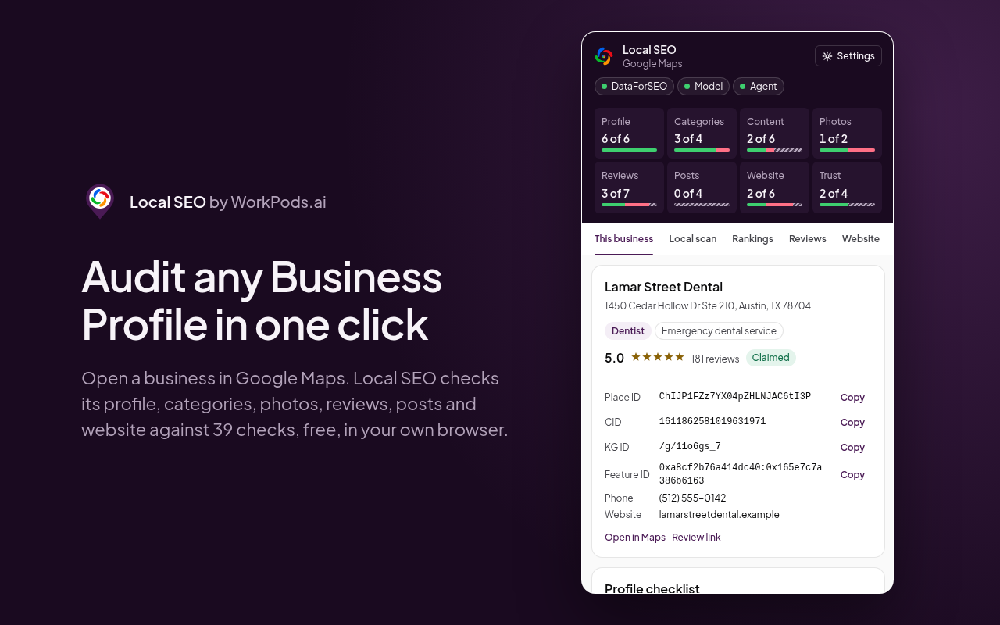
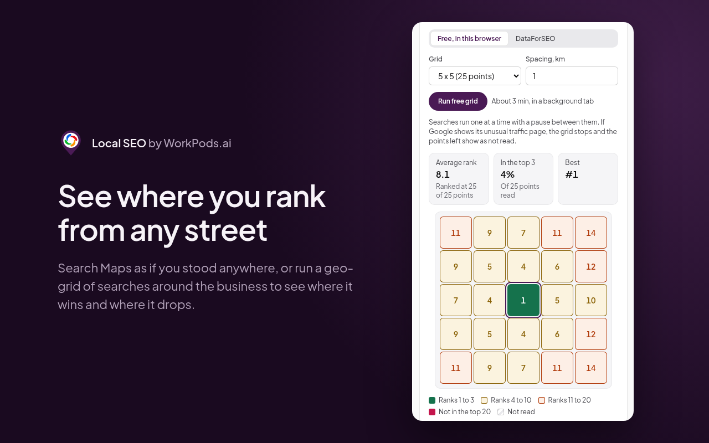
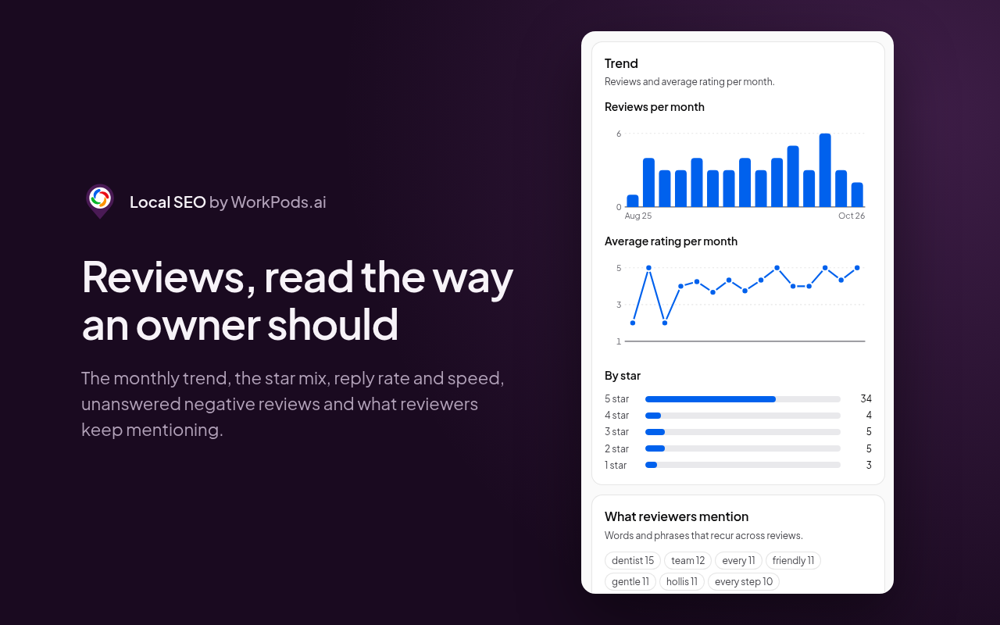
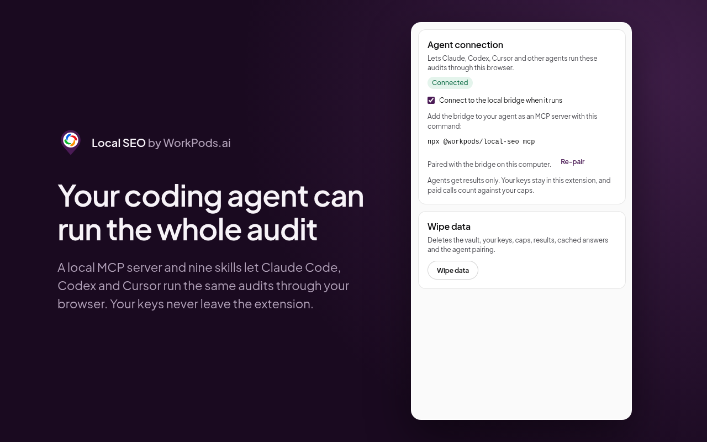

# Local SEO: free Google Business Profile audit and Maps rank checker

Local SEO is a free, open-source local SEO tool for Chrome and Firefox that audits Google Business
Profiles and shows where a business ranks in Google Maps. It is for local businesses, agencies and
SEOs who want to know why a profile is not in the map pack and what to fix first.

 
 

Local SEO reads what Google Maps shows in your own browser: a business's categories (including
the secondary ones Maps hides), profile, reviews and posts, and where it ranks for a search from
any point on the map. It runs 39 checks and says what to fix first. A local MCP server and a
skills plugin let Claude Code, Codex and other agents run the same audits. Paid data, such as
large geo-grids and full review history, uses your own DataForSEO key, kept encrypted in the
extension. It needs no account and has no telemetry.

## Install

Install [Local SEO from the Chrome Web Store](https://chromewebstore.google.com/detail/local-seo-by-workpods/bljbmngieccnjdnlahdhgklcagfcphak).

For development or release testing, you can install an unpacked build:

1. Download `local-seo-<version>-chrome.zip` from Releases and unzip it into a folder you will
   keep.
2. Open `chrome://extensions`, turn on **Developer mode**, click **Load unpacked** and choose the
   folder.
3. Pin Local SEO and click its icon to open the side panel.

To build it yourself (Node 22 or later): `npm install`, then `npm run release:zip`; the zip is in
`release/`. [Getting started](docs/getting-started.md) has the details.

## What it does

**Google Business Profile audit.** Open a business in Google Maps and click **Audit this
business**. The audit reads the profile, its primary and secondary categories, up to 50 recent
reviews, the newest post, the 20 businesses Maps shows for your search and, if you allow it, the
website. The checklist groups the 39 checks into eight sections, and **Full report** opens a
printable version.

**Local scan.** Search Maps for a service and a place, such as "dentist austin tx", and scan up to
120 results: position, primary category, rating, reviews and distance, plus which categories the
businesses use. **Show categories on the map's result cards** labels each card with its primary
category.

**Rankings and geo grid.** **Teleport** checks the rank from any point on the map. **Geo grid**
runs one Maps search from each point of a grid around the business: up to 5 x 5 free in your
browser, or up to 13 x 13 with your DataForSEO key.

**Reviews.** Rating, reviews in the last 90 days, reply rate and reply time, the monthly trend,
recurring phrases and unanswered negative reviews. Up to 100 reviews free from Maps, or the full
history with DataForSEO.

**Website against profile.** Checks that the website shows the same name, address and phone as the
profile, has LocalBusiness schema, a click-to-call link, matching hours and an embedded map. The
same check runs in CI with `npx -y @workpods/local-seo audit-website`.

**AI answers.** Asks ChatGPT, Gemini, Perplexity and Google AI Mode the question a local buyer asks
and shows whether each names the business, at what position, and which competitors it names.

**From your coding agent.** Nine skills, including `gbp-audit`, `rank-diagnosis`,
`review-strategy` and `multi-location-audit`, run through the local MCP bridge:

```bash
claude mcp add local-seo -- npx -y @workpods/local-seo mcp
```

Local SEO never writes to Google. Drafted descriptions, posts and review replies are for you to
read and paste yourself.

## Firefox

Firefox desktop 140 or later is supported. Build the package with
`npm run zip:firefox -w extension`. Firefox uses its sidebar and background event page, and stores
private settings and vault records in extension-origin IndexedDB. Its built-in data-consent
prompt covers the data optional provider features can transmit. Core audits require no paid keys.

The local bridge requires the exact Firefox installation origin shown in Settings. See
[Firefox bridge setup](docs/agents-and-skills.md#firefox).

## Questions

**Is Local SEO free?**
Yes. Profile audits, Local scan, Teleport, geo grids up to 5 x 5, up to 100 reviews from Maps and
the website check are free, with no account. Larger geo grids, the full review and post history
and category search volumes use your own DataForSEO key, encrypted in the extension under a
monthly cap you set.

**How do I audit a Google Business Profile?**
Install the extension, open the business in Google Maps and click **Audit this business** in the
side panel. Type the search it should rank for to add the competitor checks. The 39 checks cover
profile basics, categories, content, photos, reviews, posts, the website and trust, each with what
was found and how to fix it.

**Can it show a competitor's secondary categories?**
Yes. Maps hides secondary categories on the profile, but Local SEO reads them from the place data
Maps fetches. The audit lists every category a business uses, and Local scan counts the primary
categories across up to 120 businesses in a search, so you can see what the top results share.

**How is the geo grid different from a rank tracker?**
The geo grid is a rank check at one moment: it searches Maps from each point around the business
and colours the point by rank. Free grids run in your own browser, one search at a time, so a 5 x
5 grid takes about three minutes. Run it again later to compare.

**Does it change my Business Profile?**
No. Local SEO only reads what Google Maps shows in your browser. It never signs in for you, posts,
replies or edits a profile. The AI writers and skills draft descriptions, posts, review replies
and spam reports for you to check and act on yourself.

## Docs

- [Getting started](docs/getting-started.md): install, the first audit, Google's limited view,
  and Google in another language
- [Using the extension](docs/using-the-extension.md): every tab of the side panel
- [How the checks work](docs/how-checks-work.md), and the
  [list of checks](plugin/skills/gbp-audit/references/checks.md)
- [Keys and spending](docs/keys-and-spending.md): DataForSEO, Cloro and model keys, caps and prices
- [Agents and skills](docs/agents-and-skills.md): the MCP bridge, pairing, and the nine skills
- [Command line and CI](docs/command-line.md): `audit-website` for terminals and pipelines
- [Privacy and permissions](docs/privacy-and-permissions.md), and the
  [privacy policy](PRIVACY.md)

## Develop

```bash
npm install
npm run check                  # format, typecheck, tests, skill lint and build
npm run e2e -w extension       # every panel tab in demo mode, in headless Chromium
```

Load `extension/.output/chrome-mv3` unpacked to try a build. [AGENTS.md](AGENTS.md) has the rules
for contributors and agents. `store/` holds the Chrome Web Store listing and its images.

Local SEO is independent and not affiliated with Google. Google Maps and Google Business Profile
are trademarks of Google LLC.

## License

Apache-2.0; see [LICENSE](LICENSE) and [NOTICE](NOTICE).

## By WorkPods.ai

Local SEO is built by [WorkPods.ai](https://workpods.ai), an AI SEO agency. Read more on the
[Local SEO Google Business Profile audit](https://workpods.ai/tools/local-seo) page, or see
[all free WorkPods.ai SEO tools](https://workpods.ai/tools). To check a website for search
engines, AI answers and AI agents, use the sister extension,
[Agent Ready](https://github.com/WorkPodsAgents/agent-ready).
