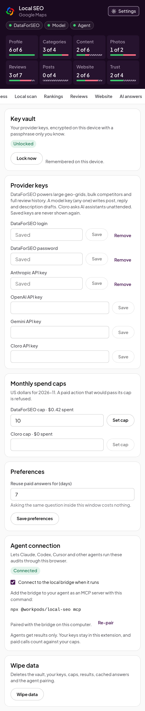

# Agents and skills

Local SEO gives your coding agent the same audits as the side panel. Two pieces make that work:

- **The bridge** (`@workpods/local-seo`) is a local MCP server. Your agent starts it and calls its
  tools, and the bridge asks the extension in your Chrome to do the work, in your browser. With no
  extension connected, only the website check runs, in Node.
- **The skills** are instructions that teach Claude Code or Codex how to run a profile audit, a
  competitor gap, a rank diagnosis or a review plan with those tools, and write the results to
  files in your project.

Nothing goes through a WorkPods server. Your API keys stay in the extension; the agent gets
results only, and every paid call counts against the caps you set in the panel.

## Set up

### 1. Add the bridge to your agent

**Claude Code**, with the skills (recommended), from this repository:

```text
/plugin marketplace add WorkPodsAgents/local-seo
/plugin install local-seo@local-seo
```

The plugin starts the bridge for you. To add only the tools, without the skills:

```bash
claude mcp add local-seo -- npx -y @workpods/local-seo mcp
```

**Codex:** add this to `~/.codex/config.toml`, and copy `plugin/skills/*` into `~/.codex/skills/`
(the same is in `plugin/codex/config.example.toml`).

```toml
[mcp_servers.local-seo]
command = "npx"
args = ["-y", "@workpods/local-seo", "mcp"]
# A geo-grid opens Maps once per point, so a large one can take several minutes.
tool_timeout_sec = 1800
```

**Cursor, Claude Desktop and other MCP clients:** add the server to the client's MCP settings
(`~/.cursor/mcp.json` for Cursor, `claude_desktop_config.json` for Claude Desktop):

```json
{
  "mcpServers": {
    "local-seo": {
      "command": "npx",
      "args": ["-y", "@workpods/local-seo", "mcp"]
    }
  }
}
```

### 2. Pair the bridge and the extension

The bridge and the extension prove to each other that they belong together with a code, so no
other program on your computer can pose as either.

1. Print the code: `npx -y @workpods/local-seo pair`. (The first `mcp` run also prints it.)
2. In the side panel, open **Settings**, find **Agent connection**, tick **Connect to the local
   bridge when it runs** and enter the code.



The badge shows **Waiting for the bridge** until your agent starts it, then **Connected**. Keep
Chrome open while the agent works.

The code is kept in `~/.config/local-seo/bridge-token`, readable only by you. To change it, run
`npx -y @workpods/local-seo pair --reset` and use **Re-pair** in the extension.

<br clear="right">

### Before the npm release

Until `@workpods/local-seo` is on npm, run the bridge from a clone of this repository (Node 22 or
later):

```bash
git clone https://github.com/WorkPodsAgents/local-seo.git local-seo
cd local-seo
npm install && npm run build -w bridge
```

Then use `node /full/path/to/local-seo/bridge/dist/cli.js` wherever these steps say
`npx -y @workpods/local-seo`. For the tools alone in Claude Code:

```bash
claude mcp add local-seo -- node /full/path/to/local-seo/bridge/dist/cli.js mcp
node /full/path/to/local-seo/bridge/dist/cli.js pair
```

To try the plugin with its skills from the clone, point the plugin's MCP server at your build
first. In `plugin/.mcp.json` of your clone (don't commit this change), set:

```json
{
  "mcpServers": {
    "local-seo": {
      "command": "node",
      "args": ["/full/path/to/local-seo/bridge/dist/cli.js", "mcp"]
    }
  }
}
```

Then add the clone as a local marketplace in Claude Code and install from it:

```text
/plugin marketplace add /full/path/to/local-seo
/plugin install local-seo@local-seo
```

## The skills

Ask in plain words; the agent picks the skill. In Claude Code you can also call one by name, such
as `/local-seo:gbp-audit`. Each skill writes its results under `./local-seo/` in your project, so
you can commit them, diff them and come back to them.

| Skill                   | Try asking                                                                 | Needs                                             |
| ----------------------- | -------------------------------------------------------------------------- | ------------------------------------------------- |
| `gbp-audit`             | "Audit the Google Business Profile of Nyack Plumbing Co"                   | The extension                                     |
| `local-competitor-gap`  | "Why do the top 3 in Maps beat us for 'emergency plumber'?"                | The extension                                     |
| `rank-diagnosis`        | "We rank first at the office but nowhere across town. Why?"                | The extension. DataForSEO for grids over 5 x 5    |
| `review-strategy`       | "Analyse our reviews, draft replies to the bad ones, plan how to get more" | The extension. DataForSEO for the full history    |
| `category-and-services` | "Which primary and secondary categories should we use?"                    | The extension. DataForSEO for search volumes      |
| `gbp-content-plan`      | "Plan a month of Google posts for us"                                      | The extension. DataForSEO for the posting history |
| `spam-fighter`          | "Find the spam listings competing with us and build a report for Google"   | The extension                                     |
| `local-ai-visibility`   | "Do ChatGPT and Gemini recommend us for best dentist in Austin?"           | The extension. A Cloro key for unattended runs    |
| `multi-location-audit`  | "Audit all twelve of our locations and find the shared problems"           | The extension                                     |

The skills draft; you decide. Nothing writes to Google: replies, posts and spam reports are files
for you to read and act on yourself.

## The tools

Skills call these tools for you; you can also ask your agent to call one directly. All are
read-only.

| Tool                  | What it does                                                                                  | Without the extension                       |
| --------------------- | --------------------------------------------------------------------------------------------- | ------------------------------------------- |
| `find_business`       | Searches Maps and returns the matching businesses with their ids                              | Needs the extension                         |
| `audit_profile`       | Runs the 39 checks on a profile and returns findings, a score, fixes and a Markdown report    | Needs the extension                         |
| `read_reviews`        | Reads reviews (browser or DataForSEO) with analytics, in pages                                | Needs the extension                         |
| `read_posts`          | Reads posts (the newest in the browser, all with DataForSEO) with cadence analytics           | Needs the extension                         |
| `local_scan`          | Reads a Maps search: every business with its category, rating, reviews and distance           | Needs the extension                         |
| `rank_at`             | The business's rank for a search seen from one point                                          | Needs the extension                         |
| `geo_grid`            | The business's rank across a grid of points; `estimateOnly` prices it first                   | Needs the extension                         |
| `category_ideas`      | The categories competitors use that the business lacks, optionally with search volumes        | Needs the extension                         |
| `check_website_nap`   | Checks a website against the profile's name, address and phone, schema, click-to-call and map | Runs in Node when given `url` and `profile` |
| `compare_businesses`  | Two to ten businesses side by side, with the gap and their ranks for a keyword                | Needs the extension                         |
| `profile_history`     | What changed on a profile between the reads saved on this computer                            | Needs the extension                         |
| `local_ai_visibility` | Whether the assistants name the business for a local question, against competitors            | Needs the extension                         |

When Maps shows a page in a language other than English, `audit_profile` and `read_reviews` say
so in their `notes`, and the fields that could not be read come back as unknown with the reason.

## Troubleshooting

| Problem                                      | Fix                                                                                                                                        |
| -------------------------------------------- | ------------------------------------------------------------------------------------------------------------------------------------------ |
| The agent says the extension isn't connected | Open Chrome, tick **Connect to the local bridge when it runs** in Settings, and check that the badge says **Connected**.                   |
| The extension says the pairing failed        | The codes differ. Run `pair` again and enter the code it prints with **Re-pair**.                                                          |
| "Port 47822 is in use"                       | Another agent session already runs a bridge. Only one bridge can talk to the extension at a time; close the other session or ask that one. |
| A paid tool is refused                       | Unlock the vault in the side panel, check the provider's key, and set a monthly cap. See [Keys and spending](keys-and-spending.md).        |
| A geo-grid times out in Codex                | Raise `tool_timeout_sec` in `~/.codex/config.toml`.                                                                                        |

## Firefox

Use Firefox desktop 140 or later. Firefox assigns a unique extension origin to each installation.
Copy `LOCAL_SEO_EXTENSION_ORIGIN=moz-extension://…` from **Settings → Agent connection** and set
that exact value in the MCP server's environment. Keep the pairing setup described above: the
origin check and mutual pairing proofs are both required. The bridge accepts only the configured
origin, never a wildcard or ordinary website origin. A bridge process serves one browser origin at
a time.

The npm package is not published as part of the extension release. To use the bridge from source,
run `npm ci` and `npm run build -w bridge` in this repository, then configure your MCP client to run
`node /absolute/path/to/local-seo/bridge/dist/cli.js mcp`. Run the same CLI with `pair` to get the
pairing code. Do not pass the code or provider keys to anyone else.
