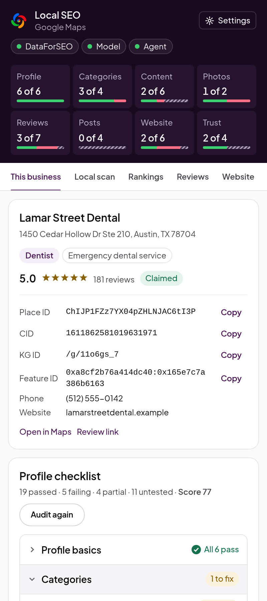

# Getting started

This guide takes you from installing Local SEO to your first profile audit, in about five minutes.
You need Chrome (or another Chromium browser, such as Edge or Brave) on a desktop.

## 1. Install the extension

**From the Chrome Web Store:** [Install Local SEO](https://chromewebstore.google.com/detail/local-seo-by-workpods/bljbmngieccnjdnlahdhgklcagfcphak).

**For developers, from a release build:**

1. Download `local-seo-<version>-chrome.zip` from this repository's Releases page.
2. Unzip it into a folder you will keep, such as `~/local-seo`. Chrome loads the extension from
   that folder every time it starts, so don't delete it.
3. Go to `chrome://extensions` and turn on **Developer mode** (top right).
4. Click **Load unpacked** and choose the folder.

To update, unzip the new build over the same folder and click the reload arrow on the extension's
card. Your settings, keys and results are kept, because the extension id never changes.

To build the zip yourself from a clone (Node 22 or later): `npm install`, then
`npm run release:zip`. The zip lands in `release/`.

## 2. Open the side panel

Pin Local SEO from the puzzle-piece menu in the toolbar, then click its icon. The panel opens on
the right and stays open as you browse.

The first time, the panel asks to **Let the panel follow your tabs**. Click **Allow**. Chrome hides
the address of the page in front of you from extensions unless you allow this, and the panel needs
it to know which business is open. Chrome calls this "read your browsing history"; the address
never leaves your browser.

## 3. Sign in to Google

Signed out, Google Maps shows a **limited view**: about five reviews, no posts and no owner's
description. Local SEO reads what Maps shows you, so sign in to any Google account in this
browser before you audit. The panel says when a read was cut short by the limited view.

## 4. Audit a business

Open a business in Google Maps (search for it and click its listing). On the **This business**
tab, type the search it should rank for, such as "emergency dentist", and click **Audit this
business**. The search is optional: it turns on the check that the primary category fits it, and
the competitors are read for it (for the primary category when you leave it empty).

The audit reads the profile, its reviews, the newest post, the website and the businesses that
rank around it, then shows:

- **The score strip** at the top: how many checks pass in each of eight groups (Profile,
  Categories, Content, Photos, Reviews, Posts, Website, Trust). Click a group to see only its
  checks.
- **The profile card:** categories (including the secondary ones Maps does not show), rating,
  claim status, the place ID, CID, Knowledge Graph ID and feature ID, each with **Copy**, and a
  **Review link** to send customers.
- **The profile checklist:** every check, with what was found and how to fix it. Fix the high
  severity ones first.

 

## 5. Where to go next

- **See who you compete with:** search Maps for your service and open **Local scan**. See
  [Using the extension](using-the-extension.md#local-scan).
- **See where you rank:** open **Rankings** for Teleport and the geo-grid. See
  [Using the extension](using-the-extension.md#rankings).
- **Let your coding agent do the work:** see [Agents and skills](agents-and-skills.md).
- **Add paid data:** see [Keys and spending](keys-and-spending.md).

## If something goes wrong

| What you see                                     | What to do                                                                                                                                         |
| ------------------------------------------------ | -------------------------------------------------------------------------------------------------------------------------------------------------- |
| "Open a business in Google Maps"                 | The tab isn't a Maps place. Search Maps for the business and click its listing, so its panel is open on the left.                                  |
| "Local SEO reads Google Maps in English for now" | Maps is in another language. Click **Reopen this page in English**, or set Google's language to English. See [below](#google-in-another-language). |
| Only a few reviews, and posts are unknown        | You are signed out of Google, so Maps shows its limited view. Sign in and audit again.                                                             |
| "Google showed its unusual traffic page"         | Google wants to check you are a person. Open Google Maps in a tab, answer it there, and try again later.                                           |
| The panel shows the wrong page                   | You didn't allow **Let the panel follow your tabs**. Click **Allow** on that prompt, or reopen the panel.                                          |
| A verdict looks wrong                            | Open an issue with the business's Maps link, the check's id and a screenshot. **Export** on This business saves the audit as Markdown or JSON.     |

## Google in another language

Local SEO reads Google Maps in English for now. Some details Maps writes only as text, such as the
photo count, the opening hours, the limited-view banner and the "Claim this business" prompt, are
matched in English. On a Maps page in another language the panel shows a notice, those fields come
back as unknown with the reason, and audits say so in their notes. Nothing is guessed.

To read in English, either:

- click **Reopen this page in English** in the notice, which adds `hl=en` to the Maps address; or
- in Google Maps, open the menu (the three lines at the top left), choose **Language** and pick
  English. This changes Google's language for your account in this browser.
