# Using the extension

The side panel has a header and six tabs. This guide goes through them in order. Each section says
what the tab is for, what it costs and how to get the most from it.

The screenshots show the panel in demo mode. Lamar Street Dental and the dentists around it in
Austin, Texas are invented: their names, addresses, phones, websites, ids and reviews are made up,
and only the numbers come from Google Maps pages saved for the tests.

## The header

- **Settings** (top right) opens the vault, your keys, spend caps, preferences and the agent
  connection. See [Keys and spending](keys-and-spending.md).
- **Connection chips** show whether DataForSEO, Cloro, a model key and the agent bridge are set up.
  A green dot means ready. Click a chip to go straight to its setting.
- **The score strip** shows, for the last audit, how many checks pass in each of eight groups. A
  bar is green for passed, red for failing and striped for untested. Click a group to list only its
  checks on This business. [How the checks work](how-checks-work.md) explains the numbers.

## This business

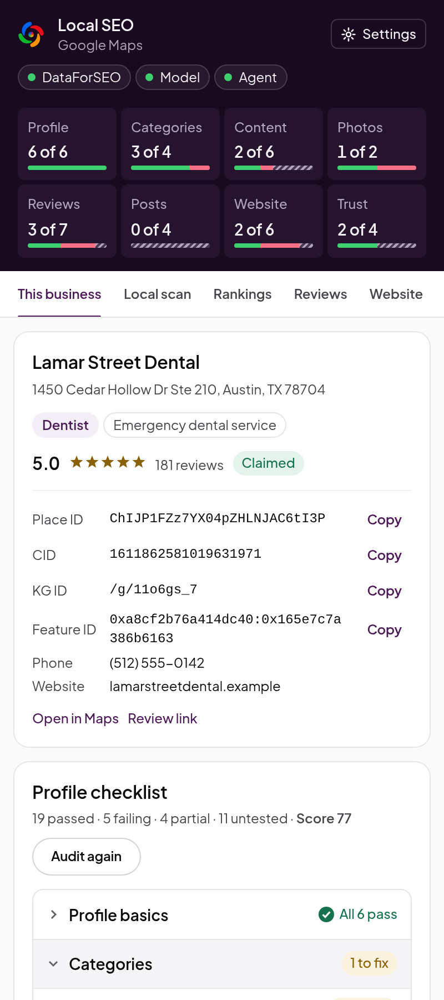

The tab you will use most. Open a business in Google Maps, optionally type the search it should
rank for, and click **Audit this business**. Click **Audit again** after a change.

An audit reads, in your browser:

- the profile in your tab, with the place data Maps fetched for it (its secondary categories,
  description and owner);
- its reviews, up to 50, sorted newest first, in a background tab;
- its newest post;
- its website, if you have allowed Local SEO to read that site on the **Website** tab;
- the 20 businesses Maps shows for the search, for the competitor checks.

 

**The profile card** shows the categories, rating, review count and claim status, and Google's ids
for the place (place ID, CID, Knowledge Graph ID and feature ID) with **Copy** buttons. **Open in
Maps** and **Review link** (the link that opens the review form) are under it.

**Changes since your last visit** lists what changed on the profile since you last audited it on
this computer: a new category, a changed phone number, more reviews. Each audit keeps a snapshot
on your device.

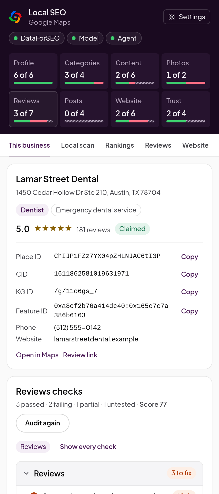

**The profile checklist** has every check, in eight groups. A group with problems opens on its own
and says how many to fix. Open a check to see what was found and how to fix it. Checks that could
not be judged say why, such as "Maps leaves the owner's description out of its limited view".
Click a group in the score strip to see only its checks, as here for Reviews.

**Not read** lists what the audit could not see and why: a website you have not allowed yet,
reviews cut short by the limited view, or a Maps page in another language.

**Export** saves the audit as Markdown or JSON. **Full report** opens it in a browser tab, with
every check in one table, for printing or sharing.

 

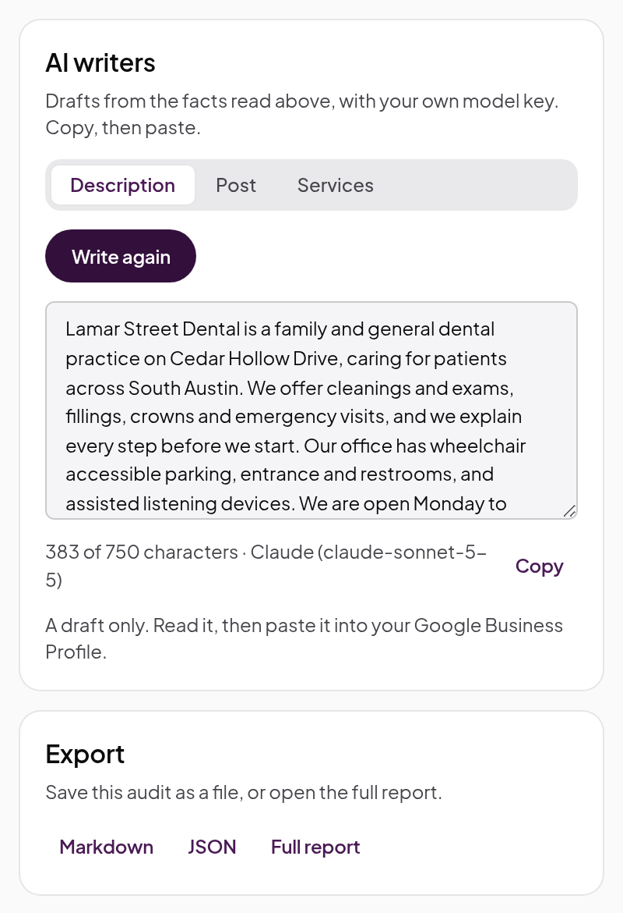

**AI writers** drafts a description, a services list or a post from the facts read above, with
your own Anthropic, OpenAI or Gemini key. Read the draft, change what you like, then paste it into
your Business Profile yourself. Local SEO never writes to Google.

 

## Local scan

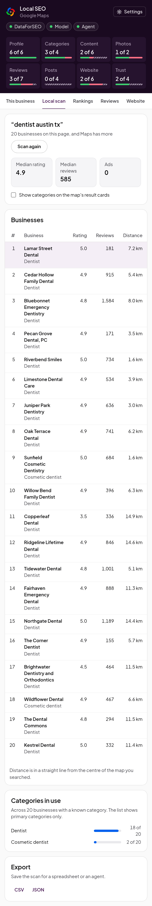

Search Google Maps for a service and a place, such as "dentist austin tx", then click **Scan this
page**. The scan reads the list Maps shows (scrolling it, up to 120 businesses) and gives you:

- the median rating and review count, and how many results are ads;
- every business with its position, primary category, rating, reviews and distance from the
  centre of the map;
- **Categories in use:** how many of the businesses use each primary category.

Tick **Show categories on the map's result cards** to label each card in the Maps list with its
primary category.

Signed out of Google, Maps shows a shorter list, and the panel says so. **Export** saves the scan
as CSV or JSON. A scan is free.

 

## Rankings

Rankings needs an audit first: it works on the business you audited last.

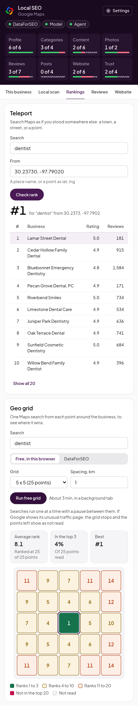

**Teleport** runs a Maps search as if you stood somewhere else. Type the search, and in **From**
type a town, a street or a point as `lat, lng`. **Check rank** shows the business's rank there and
the 20 results Maps gave, with ads marked. Free.

 

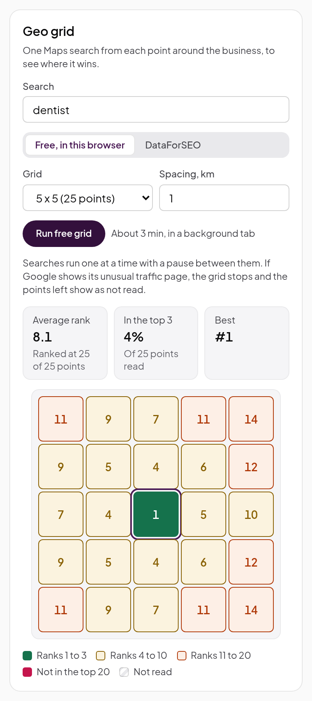

**Geo grid** runs one Maps search from each point of a square grid centred on the business, and
colours each point by the rank found there. Choose the grid size and the spacing between points.

- **Free, in this browser:** up to 5 x 5. Searches run one at a time in a background tab, with a
  pause between them so Google sees a person panning the map; a 5 x 5 grid takes about three
  minutes. If Google shows its unusual traffic page, the grid stops and the points left show as
  not read. **Stop** ends it early; you keep what was read.
- **DataForSEO:** up to 13 x 13, in seconds, at about $0.002 a point (a 7 x 7 grid is about
  $0.10). See [Keys and spending](keys-and-spending.md).

The summary gives the average rank, the share of points in the top 3 and the best rank. A point
where the business is not in the first 20 results counts as "not in the top 20".

 

## Reviews

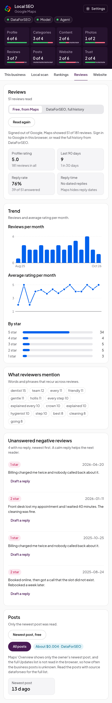

Reviews works on the business you audited last. Choose where to read the reviews, then click
**Read reviews**.

- **Free, from Maps:** up to 100, read in a background tab, newest first. Signed out, Maps shows
  only about five.
- **DataForSEO, full history:** 100, 250 or 500 reviews, with exact dates, at about $0.0015 per 10
  reviews (500 is about $0.08).

You get the profile rating, reviews in the last 90 days, reply rate and typical reply time, the
monthly trend of count and average rating, the star mix, **What reviewers mention** (words and
phrases that recur) and **Unanswered negative reviews**, each with **Draft a reply** when a model
key is set.

If Maps would not sort by Newest, the reviews are its "Most relevant" sample, which can skip recent
ones; the panel says so, and the recency checks are not judged from it.

**Posts** below shows the newest post Maps shows on the profile, free. **All posts** reads every
post from DataForSEO (about $0.003, plus $0.0015 per 10 posts), which is what tells you how often
the owner posts.

 

## Website

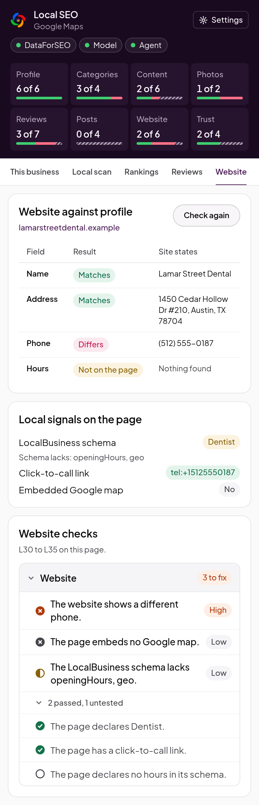

Website works on the business you audited last. Click **Check website**; the first time, Chrome
asks to let Local SEO read that site. Allowing it also lets the next audit include the website.

The check fetches the website's page from your browser and compares it with the profile:

- **Website against profile:** whether the page shows the same name, address and phone, field by
  field;
- **Local signals on the page:** LocalBusiness schema and how complete it is, a click-to-call
  link, opening hours that match the profile, and an embedded Google map.

These are checks L30 to L35. The page is read without running its JavaScript, as a crawler sees
it. Free.

 

## AI answers

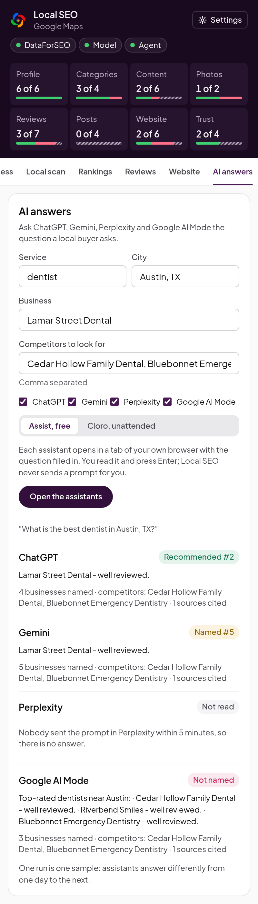

This tab asks AI assistants the question a local buyer asks ("What is the best dentist in Austin,
TX?") and shows whether each one names or recommends the business, at what position, and which
competitors it names instead. Fill in the service, the city, the business and the competitors to
look for, and choose the assistants.

- **Assist, free:** each assistant opens in a tab of your own browser (ChatGPT, Gemini, Perplexity
  and Google AI Mode) with the question filled in. You read it and press Enter; Local SEO never
  sends a prompt for you. Chrome asks once to let Local SEO read each assistant's site. Sign in to
  the assistants first. If nobody sends a prompt within five minutes, that assistant is not read.
- **Cloro, unattended:** asks ChatGPT, Gemini and Google AI Mode through Cloro with your key, with
  no tabs to watch. Cloro has no Perplexity. About $0.014 for ChatGPT and $0.012 each for Gemini
  and AI Mode.

One run is one sample: assistants answer differently from one day to the next, so compare runs
over weeks before you draw conclusions.

 

## Settings

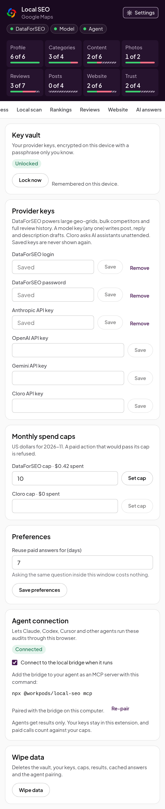

- **Key vault** and **Provider keys:** see [Keys and spending](keys-and-spending.md).
- **Monthly spend caps** and **Preferences** (how many days paid answers are reused).
- **Agent connection:** lets your coding agent use the extension. See
  [Agents and skills](agents-and-skills.md).
- **Wipe data** deletes the vault, your keys, caps, results, cached answers and the agent pairing
  from this browser.

 

## The full report

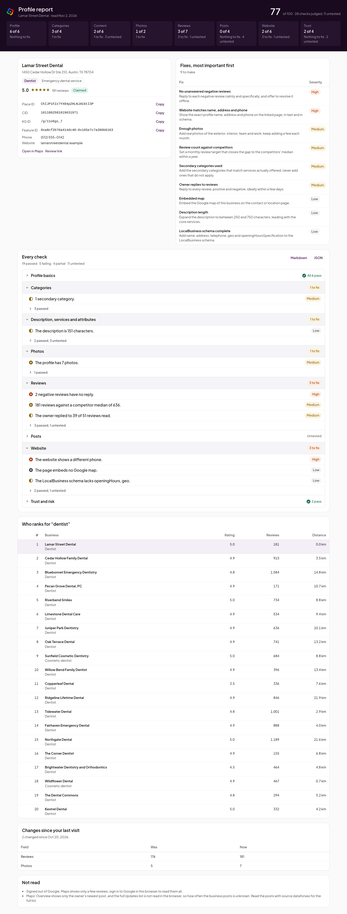

**Full report** on This business opens the last audit in a browser tab: the business, the fixes
with the most important first, every check, who ranks for the search, and what was not read.
Print it to PDF to share it.
